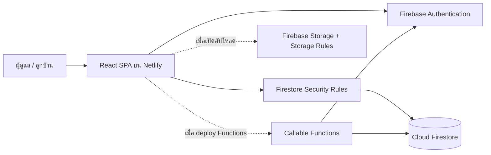

# Sena-One — System Specification

เอกสารเทคโนโลยีและความสามารถของระบบจัดการอาคารพักอาศัย Sena-One

- วันที่ปรับปรุง: 3 พฤศจิกายน 2569 (2026-11-03)
- เว็บใช้งาน: https://sena-one.netlify.app/
- Repository: https://github.com/ottowan/sena-one
- แหล่งอ้างอิง: โค้ดใน `src/`, `functions/src/`, ไฟล์ตั้งค่า และ Security Rules ใน repository นี้
- ขอบเขต: อธิบายความสามารถที่มีโค้ดรองรับ พร้อมแยกส่วนที่ยังไม่เปิดใช้หรือยังพัฒนาไม่ครบในหัวข้อ 12

## 1. วัตถุประสงค์และขอบเขตระบบ

ระบบเว็บสำหรับบริหารห้องพัก ผู้พักอาศัย สัญญาเช่า มิเตอร์น้ำและไฟฟ้า ใบแจ้งหนี้ การรับชำระเงิน ทะเบียนรถ ครุภัณฑ์ การสำรวจครุภัณฑ์ประจำปี และงานแจ้งซ่อม มีพื้นที่ใช้งานแยกสำหรับผู้ดูแลและลูกบ้าน รองรับภาษาไทย ปี พ.ศ. และหน้าจอคอมพิวเตอร์/มือถือ

## 2. ผู้ใช้และสิทธิ์

| บทบาท | รหัส | ขอบเขตการใช้งาน |
| --- | --- | --- |
| ผู้ดูแลระบบ | `admin` | เข้าหน้าผู้ดูแล จัดการข้อมูลและเปิด/ปิดรอบสำรวจ |
| เจ้าของ/ผู้รับผิดชอบอาคาร | `owner` | เข้าหน้าผู้ดูแลและใช้สิทธิ์หลักเช่นเดียวกับ admin ตาม Rules ปัจจุบัน |
| ลูกบ้าน/ผู้เช่า | `tenant` | ดูข้อมูลที่สัมพันธ์กับบัญชีและห้องของตน บันทึกมิเตอร์น้ำ แจ้งซ่อม และตอบแบบสำรวจครุภัณฑ์ |

- เข้าสู่ระบบด้วยชื่อผู้ใช้หรือเบอร์โทรศัพท์และรหัสผ่าน
- ระบบแปลงชื่อผู้ใช้/เบอร์โทรเป็นอีเมลบัญชีภายในก่อนยืนยันตัวตนผ่าน Firebase Authentication
- `/` ส่งผู้ใช้ไป `/admin` หรือ `/tenant` ตามบทบาท ผู้ที่ยังไม่เข้าสู่ระบบไป `/login`
- หน้าเว็บใช้ `ProtectedRoute` และฐานข้อมูลใช้ Security Rules ตรวจสิทธิ์ซ้ำ
- ลูกบ้านแก้บทบาทของตนเองไม่ได้ และไม่มีสิทธิ์สร้างรายการรับชำระเงินโดยตรง

## 3. เทคโนโลยี

เวอร์ชันในตารางเป็นช่วงเวอร์ชันที่ประกาศใน `package.json` การติดตั้งที่ทำซ้ำควรอิง `package-lock.json`

| ส่วนงาน | เทคโนโลยี | หน้าที่ |
| --- | --- | --- |
| Frontend | React `^19.2.7`, TypeScript `~5.9.3` | ส่วนติดต่อผู้ใช้และชนิดข้อมูล |
| Build | Vite `^7.3.6`, React plugin `^5.2.0` | Development server และ production bundle |
| UI | Chakra UI `^3.36.0`, Emotion | Component, responsive layout และ theme |
| Routing | React Router DOM `^7.18.1` | เส้นทาง SPA และพื้นที่ผู้ใช้ตามบทบาท |
| Server state | TanStack React Query `^5.101.2` | Query cache, mutation และ invalidate ข้อมูล |
| Form | React Hook Form `^7.80.0`, Zod `^4.4.3`, resolvers | จัดการและตรวจสอบฟอร์มในส่วนที่นำมาใช้ |
| Theme / motion / icons | next-themes, Framer Motion, react-icons | Light/Dark mode, animation และไอคอน |
| Font / date | Noto Sans Thai, Inter, date-fns และ utility ภายใน | ตัวอักษรไทยและการแสดงวันเดือนปี |
| Firebase client | Firebase SDK `^12.15.0` | Authentication, Firestore, Storage และ Callable Functions |
| Database | Cloud Firestore | ฐานข้อมูล document และ subcollection |
| Authentication | Firebase Authentication Email/Password | Session และบัญชีผู้ใช้ |
| File storage | Firebase Storage | โค้ดรองรับจัดเก็บรูปและหลักฐาน; ยังปิด UI อัปโหลด |
| Server functions | Firebase Functions v2, Admin SDK, Node.js 22 | รีเซ็ตรหัสผ่านและลบบัญชีโดยผู้ดูแล |
| Spreadsheet | XLSX `^0.18.5`, file-saver | อ่านไฟล์ครุภัณฑ์และส่งออก Excel |
| Hosting | Netlify | เผยแพร่ frontend จาก GitHub branch `main` |
| Testing | Node.js test runner, Playwright `^1.64.1`, Firestore Emulator | ทดสอบ logic, UI และ Security Rules |
| Quality tools | TypeScript, ESLint 9, typescript-eslint | ตรวจชนิดข้อมูลและคุณภาพโค้ด |

Frontend ติดต่อ Firebase SDK โดยตรง ไม่มี REST backend หรือ SQL server แยกสำหรับงานทั่วไป ส่วน Cloud Functions ถูกใช้เฉพาะงานบริหารบัญชีสองรายการ

## 4. โครงสร้างระบบ



| ตำแหน่ง | ความรับผิดชอบ |
| --- | --- |
| `src/App.tsx` | Routes, Providers และ QueryClient |
| `src/pages/admin/`, `src/pages/tenant/` | หน้าจอของแต่ละบทบาท |
| `src/components/` | ฟอร์ม ตาราง dialog layout และ UI ที่ใช้ซ้ำ |
| `src/services/` | การอ่าน/เขียน Firebase และกฎธุรกิจ |
| `src/hooks/` | Query และ mutation hooks |
| `src/contexts/AuthContext.tsx` | Session และข้อมูลผู้ใช้ |
| `src/lib/` | Firebase configuration, วันที่, import/export และ validation |
| `src/theme/` | สี ฟอนต์ และ theme tokens |
| `src/types/` | แบบจำลองข้อมูล TypeScript |
| `functions/src/` | Callable Functions สำหรับงานบริหารบัญชี |
| `scripts/` | ทดสอบ นำเข้า ย้ายข้อมูล และเครื่องมือบำรุงรักษา |
| `tests/ui/`, `tests/rules/` | UI fixtures และการทดสอบสิทธิ์ |

QueryClient ตั้งค่า retry 1 ครั้ง และไม่ refetch อัตโนมัติเมื่อกลับมา focus หน้าต่าง ใช้ Firestore transactions/batches ในงานที่ต้องเขียนข้อมูลสัมพันธ์กัน เช่น สัญญาและรอบสำรวจ

## 5. ฟีเจอร์สำหรับผู้ดูแล

### 5.1 Dashboard — `/admin`

- แสดงจำนวนห้อง ห้องว่าง ห้องมีผู้พัก ผู้เช่าที่ใช้งาน รายรับเดือนปัจจุบัน บิลค้างชำระ และงานแจ้งซ่อมที่รอดำเนินการ
- แสดงกิจกรรมล่าสุดและทางลัดเข้าสู่งานหลัก
- แสดงข้อมูลสัญญาที่ต้องติดตามผ่านข้อมูลสถิติและส่วนที่เกี่ยวข้องกับสัญญา

### 5.2 จัดการห้องพัก — `/admin/rooms`

- เพิ่ม แก้ไข ลบ และดูรายละเอียดห้อง เลขห้อง ชั้น ประเภท ขนาด ค่าเช่า อัตราน้ำ/ไฟ รายละเอียดและสิ่งอำนวยความสะดวก
- สถานะห้อง: ว่าง (`available`), จอง (`reserved`), มีผู้พัก (`occupied`), ซ่อมบำรุง (`maintenance`)
- ค้นหาเลขห้อง กรองชั้นและสถานะร่วมกัน ล้างตัวกรอง และเลือกมุมมองการ์ด/ตาราง/แบบย่อ
- ดูผู้พัก สัญญาปัจจุบัน ครุภัณฑ์ และประวัติมิเตอร์แยกปี
- ป้องกันงานแก้ไข/ลบห้องที่มีสัญญาใช้งานตามเงื่อนไขของหน้าและ service
- มีเครื่องมือซิงก์สถานะห้องกับสัญญา และบังคับคืนห้องสำหรับแก้ข้อมูลผิดพลาด

### 5.3 จัดการผู้เช่า — `/admin/tenants`

- เพิ่ม แก้ไข ลบ และดูข้อมูลผู้เช่า รวมชื่อ เบอร์โทร อีเมล เลขบัตร ข้อมูลติดต่อฉุกเฉิน และสถานที่ทำงาน
- บันทึกตำแหน่ง/ระดับตำแหน่งที่ใช้ประกอบการคิดค่าเช่า
- เชื่อมผู้เช่ากับบัญชี login ห้อง และสัญญา
- ตรวจสอบเบอร์โทรและเลขบัตรซ้ำ มีตัวกรองและค้นหาร่วมกับข้อมูลห้อง/สถานะ
- ดูข้อมูลรถที่ลงทะเบียนกับห้องของผู้เช่า

### 5.4 จัดการสัญญา — `/admin/contracts`

- สร้างและแก้ไขสัญญาระบุผู้เช่า ห้อง วันเริ่ม/สิ้นสุด ค่าเช่า และเงินประกัน
- ต่ออายุ ย้ายห้อง และยกเลิกสัญญา พร้อมดูรายละเอียดและสถิติการหมดอายุ
- สถานะ: `active`, `expired`, `terminated`, `renewed`
- การสร้างสัญญาที่ใช้งานต้องเลือกห้องว่าง และอัปเดตผู้พัก/สถานะห้องกับข้อมูลผู้เช่าผ่าน transaction
- การย้ายหรือยกเลิกสัญญามีการปรับความสัมพันธ์ระหว่างห้อง สัญญา และผู้เช่า
- ฟอร์มยกเลิกมีตัวเลือกคืนเงินประกัน แต่ยังไม่มีการสร้างรายการคืนเงินอัตโนมัติ

### 5.5 จัดการมิเตอร์ — `/admin/meters`

- เลือกเดือนที่บันทึกเป็นเดือน/ปี พ.ศ. และแสดงเดือนปัจจุบันที่กำลังกรอกอย่างเด่นชัด
- แยกกรอกมิเตอร์น้ำ/ไฟฟ้าทีละประเภท โดยข้อมูลที่แก้ไว้ยังคงอยู่เมื่อสลับประเภท
- แสดงเลขครั้งก่อน ช่องเลขสะสมครั้งนี้ และหน่วยที่ใช้ ตัวเลขขนาดใหญ่พร้อมสีแยกน้ำ/ไฟ
- กด Enter ไปห้องถัดไป และ Shift+Enter ย้อนกลับได้
- ค้นหาเลขห้อง/ผู้เช่า เลือกห้อง และกรองทั้งหมด ยังไม่ครบ ต้องตรวจสอบ หรือมีการแก้ไข
- สรุปจำนวนห้องที่กรอกน้ำ/ไฟและความคืบหน้า พร้อมเตือนค่าต่ำกว่าครั้งก่อน
- บันทึกเฉพาะห้องที่แก้ไข ช่องว่างไม่ถูกแปลงเป็นศูนย์ และรองรับเลขศูนย์ที่กรอกจริง
- เตือนก่อนเปลี่ยนเดือนหากมีข้อมูลยังไม่บันทึก
- นำเข้าโดยวางสองคอลัมน์ “เลขห้อง + เลขหน้าปัดสะสม” จาก Google Sheets, Excel, CSV หรือ Markdown table
- ตรวจหาห้องไม่พบ ตัวเลขผิด รายการซ้ำ และค่าที่ต้องยืนยันก่อนนำลงตาราง การนำลงตารางยังไม่บันทึกฐานข้อมูลจนกดบันทึก
- เลขครั้งก่อนอ้างอิงประวัติเดือนก่อน จากนั้นใบแจ้งหนี้เดือนก่อน และค่ามิเตอร์เริ่มต้นในห้องตามลำดับ fallback

### 5.6 ใบแจ้งหนี้และรับชำระ — `/admin/invoices`

- สร้างใบแจ้งหนี้รายห้องหรือสร้างหลายรายการจากสัญญาที่ใช้งาน (Bulk Generate)
- เลือกเดือนที่เรียกเก็บ อ่านเลขมิเตอร์ปัจจุบันและเดือนก่อน ปรับตัวเลข และเลือกรายการที่จะสร้าง
- ใน Bulk Generate เมื่อเปลี่ยนเดือน กำหนดชำระตั้งเป็นวันที่ 5 ของเดือนถัดไป เช่น พฤศจิกายน 2569 → 5 ธันวาคม 2569 และธันวาคม 2569 → 5 มกราคม 2570 โดยปรับวันเองได้
- คำนวณค่าเช่า ค่าน้ำ ค่าไฟ ค่าส่วนกลาง ค่าบำรุงมิเตอร์น้ำ และค่าใช้จ่ายเพิ่มเติม
- ดูรายละเอียด ค้นหา กรองสถานะ/เดือน เปลี่ยนสถานะ และลบใบแจ้งหนี้ผ่านเครื่องมือในหน้า
- สถานะ: รอชำระ (`pending`), ชำระแล้ว (`paid`), ค้างชำระ (`overdue`), ยกเลิก (`cancelled`)
- บันทึกการรับชำระด้วยเงินสด โอน หรือประเภท QR พร้อมวันที่ จำนวนเงิน และหมายเหตุ
- เมื่อ service บันทึกรับชำระสำเร็จ จะเปลี่ยนสถานะใบแจ้งหนี้เป็น `paid`; ยังไม่มีระบบกระทบยอดธนาคารอัตโนมัติหรือบัญชีลูกหนี้แบบแบ่งจ่ายครบวงจร
- ส่งออกใบแจ้งหนี้/ข้อมูลเรียกเก็บรายเดือนเป็น Excel

### 5.7 ทะเบียนคุมรถ — `/admin/vehicles`

- เพิ่มหลายรายการ แก้ไข ลบ และค้นหาทะเบียนรถ เชื่อมกับห้องพัก
- ประเภท: รถยนต์ รถกระบะ รถจักรยานยนต์
- เก็บทะเบียน จังหวัด ยี่ห้อ สี และสถานะสติกเกอร์
- แสดงผู้พักและเบอร์ติดต่อของห้องประกอบรายการรถ
- ทะเบียนรถใน collection `vehicles` แยกจากข้อมูลรถเดิมที่แนบกับประวัติผู้เช่า

### 5.8 ทะเบียนครุภัณฑ์ — `/admin/equipment`

- จัดการชื่อรายการและเลขครุภัณฑ์รายห้อง ดูจำนวนรายการและจำนวนที่มีเลขแล้ว
- ค้นหาด้วยเลขห้อง ชื่อรายการ หรือเลขครุภัณฑ์ และเปิดรายละเอียดห้องผ่านปุ่มดูครุภัณฑ์
- มีเครื่องมือเติมรายการครุภัณฑ์เริ่มต้นในห้อง
- นำเข้าเลขจากไฟล์ Excel ตามรูปแบบ `asset-sena1b1.xlsx` มีขั้นตอนตรวจสอบก่อนเขียน
- เติมเฉพาะเลขที่ยังขาด รักษารหัสรายการ/เลขเดิม และข้ามค่าที่ขัดแย้งหรือจับคู่ไม่แน่นอน
- รองรับการแยกเลขเตียง/ที่นอนและเลขพัดลมจากรูปแบบที่ parser รองรับ
- ไม่นำข้อมูลชื่อผู้ตอบหรือผลสำรวจเดิมที่ไม่มีปีเข้าระบบ การนำเข้าซ้ำไม่สร้างเลขซ้ำ

### 5.9 สำรวจครุภัณฑ์ประจำปี — ภายใน `/admin/equipment`

- ผู้ดูแลเลือกปี พ.ศ. และเปิดรอบได้หนึ่งรอบต่อปี โดยเก็บ year เป็น ค.ศ. ในฐานข้อมูล
- ขณะเปิดรอบ ระบบทำ snapshot รายการ ชื่อ และเลขครุภัณฑ์ของแต่ละห้อง
- ปิดรับหรือเปิดรับซ้ำในรอบเดิมได้ พร้อมติดตามห้องที่รอ/ส่งผลแล้วและดูผลแยกปี
- สภาพที่รองรับ: ปกติ ชำรุด เสื่อมสภาพ สูญไป และไม่จำเป็นต้องใช้
- ค่าที่ไม่ปกติต้องมีสาเหตุ ต้องตอบครบทุกชิ้นก่อนส่งผล และส่งแล้วแก้ไขไม่ได้
- การเปิดรับซ้ำเปิดให้ห้องที่ยังไม่ส่งทำต่อ โดยไม่ปลดล็อกผลที่ส่งแล้ว
- ประวัติไม่เปลี่ยนตามการแก้ทะเบียนครุภัณฑ์ภายหลัง
- ใช้ client transactions และ Firestore Rules ไม่ต้องใช้ Cloud Functions
- รายละเอียดวิธีใช้และข้อขัดแย้งจากไฟล์นำเข้าอยู่ใน [docs/equipment-surveys.md](docs/equipment-surveys.md)

### 5.10 งานแจ้งซ่อม — `/admin/maintenance`

- ดูรายละเอียด สร้าง แก้ไข ลบ ค้นหา และกรองรายการแจ้งซ่อม
- ข้อมูลประกอบ: ห้อง ผู้แจ้ง หัวข้อ รายละเอียด ความสำคัญ และรูปภาพเมื่อเปิดใช้ Storage
- สถานะ: รอดำเนินการ กำลังดำเนินการ เสร็จสิ้น และยกเลิก
- ความสำคัญ: ต่ำ ปานกลาง สูง และเร่งด่วน

### 5.11 รายงาน — `/admin/reports`

- ภาพรวมจำนวนห้องตามสถานะและกราฟรายรับย้อนหลัง 6 เดือน
- รายงานการเงินแยกเดือนและสถานะ พร้อมส่งออก Excel
- รายงานสาธารณูปโภครายห้อง แสดงเลขเก่า เลขปัจจุบัน และหน่วยน้ำ/ไฟที่ใช้ พร้อมส่งออก Excel
- ข้อมูลรายรับและสถานะชำระอ้างอิงรายการในระบบ ไม่ใช่ข้อมูลจากธนาคารโดยตรง

### 5.12 ผู้ใช้งาน — `/admin/users`

- สร้างบัญชีด้วยชื่อ เบอร์โทร รหัสผ่าน และบทบาท
- สร้างผ่าน Firebase App แยกชั่วคราว เพื่อไม่ทำให้ session ผู้ดูแลหลุด
- ดูรายชื่อ ค้นหา กรอง และแก้ข้อมูล/บทบาทตามสิทธิ์
- มี UI รีเซ็ตรหัสผ่านและลบบัญชี ซึ่งต้อง deploy Callable Functions ก่อนจึงใช้งานได้

### 5.13 ตั้งค่า — `/admin/settings`

- ตั้งอัตราค่าน้ำ ค่าไฟ ค่าส่วนกลาง และค่าบำรุงมิเตอร์น้ำ
- ตั้งค่าเช่าและค่าส่วนกลางตามระดับตำแหน่ง: ปฏิบัติการ ชำนาญการ ชำนาญการพิเศษ และเชี่ยวชาญ
- ค่าที่ตั้งถูกใช้ประกอบการสร้างใบแจ้งหนี้ใหม่ตามลำดับการคำนวณในหัวข้อ 8

## 6. ฟีเจอร์สำหรับลูกบ้าน

| เส้นทาง | ฟีเจอร์ |
| --- | --- |
| `/tenant` | Dashboard ข้อมูลห้อง/สัญญา บิล สรุปการใช้สาธารณูปโภคและทางลัดงานส่วนตัว |
| `/tenant/bills` | ดูใบแจ้งหนี้ของตน รายละเอียดค่าเช่า/น้ำ/ไฟ ค่าใช้จ่าย กำหนดชำระและสถานะ |
| `/tenant/water-meter` | บันทึกมิเตอร์น้ำของห้องและดูประวัติย้อนหลังแยกปี มีการตรวจใบแจ้งหนี้ที่ออกแล้วใน UI ก่อนให้แก้ |
| `/tenant/equipment` | ดูรายการครุภัณฑ์ห้อง ตอบแบบสำรวจในรอบที่เปิด และดูผลย้อนหลังแยกปี |
| `/tenant/maintenance` | ส่งคำขอแจ้งซ่อมห้องของตนและติดตามสถานะ |

ลูกบ้านไม่มีหน้าบริหารห้อง ผู้ใช้ อัตราค่าใช้จ่าย หรือการรับชำระเงิน และการดูประวัติสำรวจอิงห้องที่ตนเป็นผู้พักปัจจุบัน

## 7. แบบจำลองข้อมูลหลัก

| Collection / document | ข้อมูลสำคัญและความสัมพันธ์ |
| --- | --- |
| `users/{uid}` | บทบาท ชื่อ เบอร์โทร อีเมลภายใน และข้อมูลบัญชี ใช้ uid เดียวกับ Firebase Auth |
| `username_lookup/{username}` | จับคู่ชื่อผู้ใช้กับ uid/email สำหรับ login |
| `phone_lookup/{normalizedPhone}` | จับคู่เบอร์โทรที่ปรับรูปแบบกับ uid/email สำหรับ login |
| `rooms/{roomId}` | เลขห้อง ชั้น สถานะ อัตราค่าใช้จ่าย มิเตอร์ตั้งต้น ผู้พักปัจจุบัน และ array `equipment` |
| `tenants/{tenantId}` | ข้อมูลผู้พัก `user_id` เชื่อมบัญชี และ `current_room_id` เชื่อมห้อง |
| `contracts/{contractId}` | `tenant_id`, `tenant_uid`, `room_id`, ระยะเวลา ค่าเช่า เงินประกัน และสถานะ |
| `history_meter/{roomId}_{YYYY-MM}` | `room_id`, `month`, `water_meter`, `electricity_meter` ใช้รหัสแน่นอนต่อห้อง/เดือน |
| `invoices/{invoiceId}` | สัญญา ผู้เช่า ห้อง เดือนเรียกเก็บ เลขมิเตอร์ หน่วย ค่าใช้จ่าย กำหนดชำระและสถานะ |
| `payments/{paymentId}` | ใบแจ้งหนี้ ยอด วิธี/วันที่ชำระ หมายเหตุ หลักฐาน และผู้บันทึก |
| `vehicles/{vehicleId}` | `room_id`, ประเภท ทะเบียน จังหวัด ยี่ห้อ สีและสติกเกอร์ |
| `maintenance_requests/{requestId}` | ห้อง ผู้แจ้ง รายละเอียด รูปภาพ ความสำคัญ และสถานะ |
| `app_settings/singleton` | อัตราน้ำ/ไฟ ค่าส่วนกลาง ค่าบำรุงมิเตอร์น้ำ |
| `position_rent_rates/{positionLevel}` | ค่าเช่าและค่าส่วนกลางแยกระดับตำแหน่ง |
| `equipment_survey_rounds/{year}` | ปี สถานะเปิด/ปิด จำนวนห้อง ผู้เปิดและเวลาเปิด |
| `equipment_survey_rounds/{year}/rooms/{roomId}` | Snapshot ครุภัณฑ์ สถานะห้องสำรวจ จำนวนคำตอบและข้อมูลผู้ส่ง |
| `equipment_survey_rounds/{year}/rooms/{roomId}/responses/{equipmentId}` | สภาพ สาเหตุ ผู้ตอบและเวลาปรับปรุงรายชิ้น |
| `deposits`, `notifications`, `bookings` | มี type/Rules รองรับบางส่วน แต่ไม่มีโมดูลหน้าใช้งานครบวงจรแยกใน Routes ปัจจุบัน |

Firestore ไม่มี relational join แบบ SQL จึงใช้ service อ่านเอกสารที่เกี่ยวข้องและ helper `fetchByIds` รวมข้อมูล ส่วน snapshot ผลสำรวจแยกจากทะเบียนปัจจุบันเพื่อเก็บประวัติ

## 8. กฎข้อมูลและการคำนวณ

### วันที่และรอบบิล

- UI แสดงเดือนภาษาไทยและปี พ.ศ.; ค่าที่จัดเก็บใช้ปี ค.ศ.
- เดือนมิเตอร์ใช้ `YYYY-MM`; ใบแจ้งหนี้ใหม่ normalize เดือนเรียกเก็บเป็น `YYYY-MM-01`; วันชำระใช้ `YYYY-MM-DD`
- การกรองใบแจ้งหนี้รายเดือนใช้ขอบเขตตั้งแต่วันแรกของเดือนจนก่อนวันแรกของเดือนถัดไป
- Bulk Generate ตั้งวันครบกำหนดเป็นวันที่ 5 เดือนถัดจากเดือนที่เลือก รองรับธันวาคมข้ามปี และการเปลี่ยนวันเอง

### การคิดค่าใช้จ่ายใบแจ้งหนี้

```text
หน่วยที่ใช้ในฟอร์มสร้างบิล = max(0, เลขครั้งนี้ - เลขครั้งก่อน)
ค่าน้ำ = หน่วยน้ำ × อัตราน้ำ
ค่าไฟ = หน่วยไฟ × อัตราไฟ
ยอดรวม = ค่าเช่า + ค่าน้ำ + ค่าไฟ + ผลรวมค่าใช้จ่ายเพิ่มเติม
```

- ค่าเช่า: ใช้อัตราตามระดับตำแหน่งเมื่อมีและมากกว่า 0 มิฉะนั้นใช้ค่าเช่าในสัญญา และ fallback ค่าเช่าห้องเมื่อค่าในสัญญาเป็น 0
- อัตราน้ำ: จากค่าระบบ หรือ fallback 18 บาท/หน่วยตามโค้ดปัจจุบัน
- อัตราไฟ: จากห้อง ก่อนค่าระบบ และ fallback 8 บาท/หน่วยตามโค้ดปัจจุบัน
- ค่าส่วนกลาง: ใช้ค่าตามระดับตำแหน่งเมื่อมี มิฉะนั้นค่าระบบ
- ค่าส่วนกลางและค่าบำรุงมิเตอร์น้ำที่มากกว่า 0 ถูกเพิ่มในรายการค่าใช้จ่ายเพิ่มเติม
- หน้าจดมิเตอร์แสดงคำเตือนค่าต่ำกว่าครั้งก่อน ผู้ดูแลต้องตรวจค่าก่อนออกบิล เพราะฟอร์มออกบิลใช้ `max(0, …)`

### แบบสำรวจประจำปี

- ตรวจปีช่วง ค.ศ. 2000–2100 และไม่สร้างรอบปีซ้ำ
- เปิดรอบ/นำเข้าเลขครุภัณฑ์รองรับไม่เกิน 450 ห้องต่อครั้งตาม service
- ต้องตอบรายการ snapshot ครบและไม่ซ้ำ ใช้เฉพาะสภาพที่กำหนด 5 ค่า
- สาเหตุยาวไม่เกิน 2,000 ตัวอักษร กรณีผิดปกติต้องมีข้อความที่มีความหมายตาม validation/Rules
- บันทึกคำตอบรายชิ้นพร้อมเพิ่มตัวนับแบบ transaction แล้วจึงยืนยันส่งเมื่อครบ; การ retry รองรับคำตอบที่บันทึกบางส่วนไว้แล้ว
- Rules ป้องกันการปลอมจำนวนคำตอบ การตอบข้ามห้อง และการแก้คำตอบหลังยืนยันส่ง

## 9. UX/UI และการใช้งานร่วม

- Responsive layout: sidebar บน desktop และเมนูมือถือ พร้อมตาราง/การ์ดตามบริบท
- รองรับ Light/Dark mode ใช้สีหลักโทน teal แยกน้ำด้วยสีน้ำเงิน ไฟด้วยสีส้ม และคำเตือนสีแดง
- ใช้ Noto Sans Thai ร่วมกับ Inter และปฏิทินภาษาไทยที่แสดงปี พ.ศ.
- มีองค์ประกอบร่วมสำหรับหัวหน้า สถิติ ค้นหา ตัวกรอง ข้อผิดพลาดและการลองใหม่
- ฟอร์มและปุ่มสำคัญมี loading/disabled state ตามการทำงาน แต่ข้อจำกัดเฉพาะแต่ละหน้าควรอ้างอิง implementation ของหน้านั้น
- ไม่มีการรับรองมาตรฐาน accessibility หรือ SLA เชิงตัวเลขจากเอกสารนี้

## 10. ความปลอดภัยและไฟล์

- Firestore Rules ตรวจบทบาทจาก `users/{uid}.role` และความสัมพันธ์ผู้พักกับห้อง ไม่ใช้ custom claims เป็นแหล่งบทบาทหลัก
- Lookup สำหรับ login อ่านได้เฉพาะ document key ก่อนเข้าสู่ระบบ ไม่อนุญาต list collection
- ลูกบ้านอ่านข้อมูลตาม uid/ห้องที่ Rules อนุญาต สร้างแจ้งซ่อมห้องตนเอง และอ่าน/เขียนประวัติมิเตอร์ห้องตนเองตาม Rules ปัจจุบัน
- การตรวจว่ามีบิลแล้วก่อนแก้มิเตอร์น้ำเป็นเงื่อนไข UI; Rules ของ `history_meter` ยังไม่บังคับล็อกตามสถานะบิล
- การส่งแบบสำรวจถูกตรวจซ้ำใน Rules และล็อกข้อมูลหลังส่ง ไม่พึ่ง UI อย่างเดียว
- Storage Rules ปัจจุบันกำหนดให้ต้อง login จำกัดไฟล์ต่ำกว่า 10 MB; รูปห้อง/แจ้งซ่อมต้องเป็น `image/*` ขณะที่ payment slips ไม่บังคับชนิดไฟล์
- สิทธิ์ Storage ปัจจุบันยังเป็นระดับผู้ login ใน prefix ที่กำหนด ไม่ได้แยกเจ้าของไฟล์ตามห้องใน Rules
- Prefix ไฟล์ที่รองรับในโค้ด: `room-images/`, `maintenance-images/`, `payment-slips/`
- `.env`, service account, backups และไฟล์ Excel ต้นทางถูก ignore; ไม่เก็บ credentials หรือข้อมูลบุคคลจริงใน specification นี้
- การสำรองที่มีอยู่เป็นเครื่องมือรายงาน/นำเข้า/ล้างข้อมูลเฉพาะงาน ไม่ใช่ระบบ backup ตามกำหนดเวลา

## 11. ติดตั้ง ทดสอบ และเผยแพร่

### พัฒนาในเครื่อง

```powershell
npm ci
npm run dev
```

ตั้งค่าจาก `.env.example` โดยใช้ตัวแปรต่อไปนี้ทั้งในเครื่องและ Netlify build environment:

```text
VITE_FIREBASE_API_KEY
VITE_FIREBASE_AUTH_DOMAIN
VITE_FIREBASE_PROJECT_ID
VITE_FIREBASE_STORAGE_BUCKET
VITE_FIREBASE_MESSAGING_SENDER_ID
VITE_FIREBASE_APP_ID
```

ห้ามนำ service account private key ไปใส่ในตัวแปร `VITE_*` เพราะค่าเหล่านี้ถูกฝังใน frontend bundle

### คำสั่งตรวจสอบ

| คำสั่ง | หน้าที่ |
| --- | --- |
| `npm run type-check` | ตรวจ TypeScript |
| `npm run build` | สร้าง production bundle ใน `dist/` |
| `npm run lint` | เรียก ESLint ทั้ง repository |
| `npm test` | Regression tests ของ filters, meter paste, วันที่ไทยและครุภัณฑ์ |
| `npm run test:ui` | Playwright บน Chrome desktop/mobile ด้วย fixture แยกจากข้อมูลจริง |
| `npm run test:surveys` | ทดสอบ service/Rules กับ Firestore Emulator `demo-sena-one`; ต้องมี Java 21+ |

UI tests ครอบคลุมการแสดงผลหลายหน้า Light/Dark, ตัวกรองมิเตอร์, การกรอกน้ำ/ไฟ, วันครบกำหนด Bulk Generate และแบบสำรวจครุภัณฑ์

### เผยแพร่

- Netlify ใช้ `npm run build`, publish `dist/` และ rewrite เส้นทาง SPA ไป `index.html` ตาม `netlify.toml`
- GitHub `main` เชื่อมกับการเผยแพร่ frontend บน Netlify
- Firebase project ที่ใช้: `sena-one`; Callable Functions กำหนด region `asia-southeast1`
- Firestore Rules/Indexes และ Storage Rules ต้อง deploy แยกจาก Netlify:

```powershell
npx firebase deploy --only firestore:rules,firestore:indexes,storage --project sena-one
```

- Functions ต้องติดตั้ง dependency ใน `functions/`, ใช้ Node.js 22 และ Firebase plan ที่รองรับการ deploy Functions:

```powershell
npm --prefix functions ci
npm run deploy:functions
```

- มี Firebase Hosting configuration สำรองใน `firebase.json`; คำสั่ง `npm run deploy` ชี้ไป Firebase Hosting ไม่ใช่การ deploy Netlify

### เครื่องมือดูแลข้อมูล

| คำสั่ง | หน้าที่และเงื่อนไข |
| --- | --- |
| `npm run migrate:firestore -- --dry-run` | ตรวจการย้าย seed ก่อนเขียนจริง ต้องมี Admin credentials ตาม README |
| `npm run import:assets -- --dry-run` | ตรวจไฟล์เลขครุภัณฑ์และรายการที่จะเติม |
| `npm run import:assets -- --apply` | สำรองเอกสารห้องแล้วเติมเฉพาะเลขที่ขาด พร้อม precondition ป้องกันเขียนทับข้อมูลที่เปลี่ยนพร้อมกัน |
| `node scripts/clear-meter-month.cjs YYYY-MM` | ตรวจจำนวนรายการมิเตอร์เดือนที่ระบุโดยไม่ลบ |
| `node scripts/clear-meter-month.cjs YYYY-MM --apply` | สำรองใน `backups/` แล้วลบเฉพาะประวัติมิเตอร์เดือนนั้นแบบ atomic พร้อมตรวจ updateTime และตรวจผลหลังลบ; ไม่ลบใบแจ้งหนี้ |

เครื่องมือนำเข้าเลขครุภัณฑ์และล้างมิเตอร์ใช้บัญชี Firebase CLI ที่เข้าสู่ระบบไว้ การใช้งานจริงต้องอยู่ในขอบเขตที่ผู้รับผิดชอบอนุมัติ

## 12. สถานะและข้อจำกัดที่ต้องทราบ

| รายการ | สถานะจากโค้ดและการตรวจในงานนี้ |
| --- | --- |
| การวางข้อมูลจาก Google Sheets | ใช้ copy/paste ได้ ยังไม่มีการเชื่อม Google Sheets URL/API หรือ sync อัตโนมัติ |
| การอัปโหลดไฟล์ | มี service และ UI รองรับบางส่วน แต่ `STORAGE_ENABLED = false` ใน `src/lib/firebase.ts`; ต้องเปิด Storage, deploy Rules และเปิด flag ก่อน |
| รีเซ็ตรหัสผ่าน/ลบบัญชี | มีสอง Callable Functions: `adminResetUserPassword`, `adminDeleteUserAccount`; ตอนตรวจระบบก่อนหน้านี้ Functions ยังไม่เปิดใช้ จึงไม่ถือว่าพร้อมใช้งานเพียงเพราะมีปุ่ม |
| การสำรวจครุภัณฑ์ | ใช้ Firestore โดยตรงและ Rules ที่ deploy แล้ว ไม่ขึ้นกับ Functions สองรายการข้างต้น |
| คืนเงินประกัน | มีข้อมูลและตัวเลือกในฟอร์ม แต่การสร้างรายการคืนเงินอัตโนมัติยังเป็น TODO |
| การชำระด้วย QR | มีประเภทวิธีรับชำระ ยังไม่มี payment gateway, สร้าง QR ธนาคารหรือยืนยันรับเงินอัตโนมัติครบวงจร |
| Notifications / Bookings | มีแบบจำลอง/Rules แต่ไม่มีหน้าจองหรือระบบส่งแจ้งเตือนอัตโนมัติครบวงจรใน Routes |
| สิทธิ์การแนบไฟล์ | Storage Rules ยังไม่ได้แยกเจ้าของตามห้อง จึงควรทบทวนก่อนเปิดข้อมูลไฟล์ส่วนบุคคล |
| ระบบออฟไลน์และงานเบื้องหลัง | ไม่มี service worker/PWA offline workflow หรือ scheduled job ที่กำหนดไว้ในโค้ดหลัก |
| Audit log | เก็บเวลาหรือผู้ทำรายการในบางโมดูล แต่ไม่มี audit trail รวมทุกการเปลี่ยนแปลงทั้งระบบ |
| การรองรับหลายอาคาร | ไม่มีโมเดลแยก tenant organization/building และสิทธิ์หลายอาคารครบวงจร |

## 13. แหล่งข้อมูลสำหรับปรับปรุงเอกสาร

เมื่อเพิ่มฟีเจอร์หรือเปลี่ยนกฎธุรกิจ ให้ปรับ specification นี้พร้อมโค้ด โดยตรวจจาก:

- เส้นทางและบทบาท: `src/App.tsx`, `src/components/ProtectedRoute.tsx`
- แบบจำลอง: `src/types/index.ts`, `src/types/equipmentSurvey.ts`
- เทคโนโลยี: `package.json`, `functions/package.json`
- การคำนวณ/เขียนข้อมูล: `src/services/`
- สิทธิ์: `firestore.rules`, `storage.rules`, `functions/src/index.ts`
- Deploy: `netlify.toml`, `firebase.json`, `src/lib/firebase.ts`, [README.md](README.md)
- แบบสำรวจและนำเข้า: [docs/equipment-surveys.md](docs/equipment-surveys.md)
- การทดสอบ: `scripts/*.test.cjs`, `tests/ui/`, `tests/rules/`
